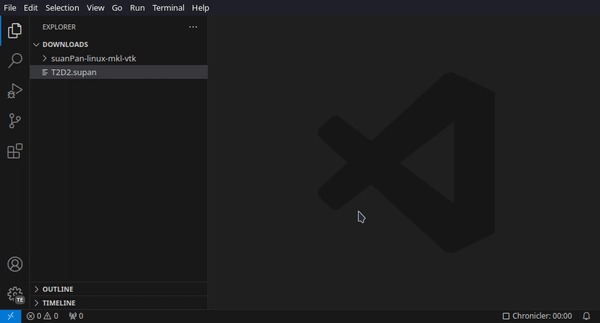

# suanPan

[🧮 **suanPan**](https://tlcfem.github.io/suanPan/) is an open source, parallel and heterogeneous finite element analysis framework.

This extension provides syntax highlighting and rich language support for `suanPan` model files.

> [!IMPORTANT]
> If you're using autocomplete tools such as Copilot, it’s advisable to turn the feature off to prevent potential conflicts.
>
> ```json
> "github.copilot.enable": {
>     "suanPan": false
> }
> ```

## Language support

On top of syntax highlighting and snippets, opening a `.sp` / `.supan` file enables:

- **Hover** — documentation and syntax for commands, object types, `$variables`, DoF identifiers and output tokens.
- **Completion** — commands, the object types of each category, DoF identifiers, `set` properties and their values, referenced object tags, and `$variables`.
- **Signature help** — the syntax of the current command with the active parameter and its default.
- **Diagnostics** — unknown commands, unknown object types, duplicate tags, missing required arguments, invalid DoF identifiers and undefined `$variables`.
- **Document symbols** — an outline of the objects and variables in the file.
- **Go to definition** — jump to the definition of a tag or a `$variable`.

The knowledge behind these features is generated from the suanPan manual and the
model source; see [`docs/DESIGN.md`](docs/DESIGN.md). Set
`"suanpan.languageFeatures": false` to disable it.

## Quick Start

1. download `suanPan`
2. install this extension `ext install tlc.suanpan`
3. enable tab completion (`Settings` -> `Editor: Tab Completion` -> `On`)
4. set path to the `suanPan` executable (`Settings` -> `suanPan` -> `Path`)
5. open a model file and edit
6. perform the analysis via `Ctrl+Shift+P` -> `suanPan: Run this model in suanPan`


## Demo


